  

## Hi, I'm Ana 👋

I'm a **Data and Artificial Intelligence Analyst at Fundación Televisa** and a Computer Science student at UNAM's School of Sciences. I build AI agents that work with text and images, automate workflows with n8n, and train machine learning models in Python.

- 🤖 Building an AI educational assistant: an n8n workflow that combines AI agents, image analysis and MySQL
- 🐍 Python Expert at Lottus Education
- 👩‍🏫 Instructor at Tecnolochicas, and former math and physics teacher
- 🌎 Spanish (native) and English (B2)

## Tech stack

**AI and automation**

**Data and machine learning**

**Databases and tools**

## Featured projects

| Project | What it does | Built with | Result |
| --- | --- | --- | --- |
| **AI educational assistant** | End-to-end automated workflow that evaluates the images users submit as evidence and manages conversation context | n8n, AI agents, computer vision, MySQL | Work project, private code |
| [**Hate speech classification**](https://github.com/AnnaCUGA/Hate-Speech-Classification) | Multiclass classifier that separates harmless messages from five kinds of hate speech on social media | scikit-learn, TF-IDF, Random Forest | 0.84 accuracy |
| [**Diabetes forecast for Mexico**](https://github.com/AnnaCUGA/PrediccionDiabetes_2024-2025) | Time-series forecast of diabetes cases for 2024 and 2025 from data by state since 2000 | pandas, statsmodels, ARIMA, Prophet | Prophet chosen for best fit |
| [**Sleep disorder analysis**](https://github.com/AnnaCUGA/Analisis-de-transtorno-del-sue-o) | Study of 374 patients and a model that supports an initial screening for insomnia and sleep apnea | pandas, Seaborn, Plotly, scikit-learn | 90% F1-score |
| [**Alzheimer's detection from brain images**](https://github.com/AnnaCUGA/Brain-Xray-Alzheimer-Detection) | Image classification model for diagnostic support | Python, machine learning | Class project |

## Education and certifications

- **B.Sc. in Computer Science**, School of Sciences, UNAM (2021 – present)
- **Data Scientist Jr. diploma**, Tecnológico Nacional de México (2024)
- **Data Scientist Jr. course**, BEDU and Tecnolochicas (2023 – 2024)

## Let's connect

