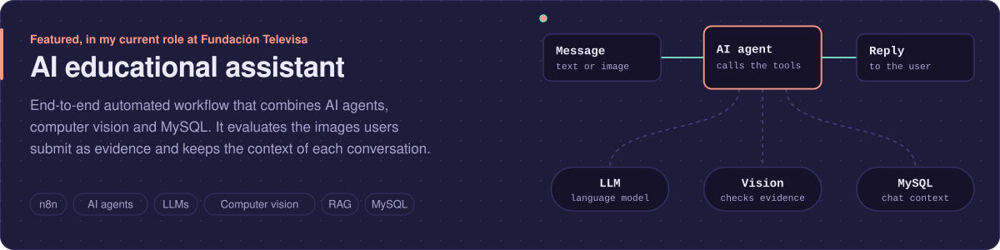

  
  
  

## What I do

I'm a **Data and Artificial Intelligence Analyst at Fundación Televisa**. My work sits where language models meet real operations: agents that hold a conversation, look at a photo, check it against rules, and write the result to a database.

<table>
  <tr>
    <td width="33%" valign="top">
      <h3>🤖 AI agents</h3>
      Multimodal assistants that combine LLMs and vision models, with retrieval (RAG) so answers come from the right documents.
    </td>
    <td width="33%" valign="top">
      <h3>⚙️ Automation</h3>
      End-to-end workflows in n8n that connect messaging channels, AI models, storage and SQL databases.
    </td>
    <td width="33%" valign="top">
      <h3>📊 Data and ML</h3>
      Exploratory analysis, ETL and predictive models in Python: classification, NLP and time series.
    </td>
  </tr>
</table>

## Featured projects

  
  

  
  

## Tech stack

<table>
  <tr>
    <td width="24%"><b>AI and agents</b></td>
    <td>
      
      
      
      
      
      
      
    </td>
  </tr>
  <tr>
    <td><b>Automation and messaging</b></td>
    <td>
      
      
      
      
    </td>
  </tr>
  <tr>
    <td><b>Data and machine learning</b></td>
    <td>
      
      
      
      
      
      
      
    </td>
  </tr>
  <tr>
    <td><b>Visualization</b></td>
    <td>
      
      
      
      
    </td>
  </tr>
  <tr>
    <td><b>Databases and cloud</b></td>
    <td>
      
      
      
      
    </td>
  </tr>
  <tr>
    <td><b>Tools</b></td>
    <td>
      
      
    </td>
  </tr>
</table>

## Experience

| When | Role | Where |
| --- | --- | --- |
| Jan 2026 – present | **Data and Artificial Intelligence Analyst** | Fundación Televisa |
| Apr 2025 – present | **Python Expert** | Lottus Education |
| Dec 2025 | **Instructor** | Tecnolochicas, a Fundación Televisa program |
| Jan – Jun 2023 | **Math and Physics Teacher** | CEFIMAT |

## Education and certifications

- 🎓 **B.Sc. in Computer Science**, School of Sciences, UNAM (2021 – present)
- 📜 **Data Scientist Jr. diploma**, Tecnológico Nacional de México (2024)
- 📜 **Data Scientist Jr. course**, BEDU and Tecnolochicas (2023 – 2024)
- 🌎 Spanish (native) and English (B2)

